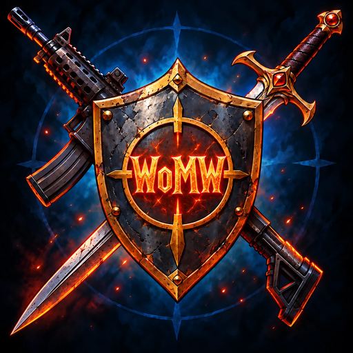

<div align="center">
  
  <h1>World of Modern Warfare</h1>
  <p><b>Azeroth's world, Modern Warfare's guns.</b> A first-person shooter in a classic MMO world.</p>
  <p><a href="https://womw.net">womw.net</a> · <a href="https://discord.gg/PgzdqFmHv">Discord</a> · <a href="https://www.reddit.com/r/womw/">r/womw</a></p>
</div>

> **Unofficial, non-commercial fan project.** Not affiliated with or endorsed by Blizzard
> Entertainment or Activision. World of Warcraft is (c) and TM Blizzard Entertainment, Inc.;
> Call of Duty and Modern Warfare are (c) and TM Activision Publishing, Inc. **You must own and have legal access
> to World of Warcraft and the original Call of Duty: Modern Warfare 2 (2009) to play.** No game
> client is included. A few files here are derived from those games and stay their owners'
> property ([`NOTICE.md`](NOTICE.md), "Third-party game data").

World of Modern Warfare (WOMW) turns a World of Warcraft 1.12 world into a shooter. You see
Azeroth in first person, aim with the mouse and fight with a modern arsenal, while the classes,
quests, creatures and zones of the classic world stay around you. The server referees every
round, so it plays as a shared online world with friends.

It is a very early alpha: expect bugs, missing pieces and big changes.

## Screenshots

<!-- Screenshots go here: docs/screenshots/*.png (add them before publishing). -->
_Coming soon._

## Features

- **First-person gunplay** refereed by the server: hitscan and projectile rounds checked against
  rewound hitboxes, damage by range and hit location, aim down sights, recoil, sway and stances
  (crouch, prone, sprint, mantle).
- **A modern arsenal** with lore-friendly names: weapons, attachments, camos, equipment, perks,
  deathstreaks and killstreaks, unlocked through in-game achievements.
- **Kits**: five loadouts per character, edited at Quartermasters, trainers and innkeepers.
- **Classes that answer guns**: three core abilities and six picks per class, free-aim spells
  cast from your hands, first-person melee.
- **Companions** that fight beside you, level, learn moves, evolve (some into mounts) and trade.
- **Construction**: destructible structures in the open world, and protected homestead plots.
- **Downed and revive**, area looting, ragdolls, damage-direction arcs, bouncing grenades.
- **A launcher** that installs itself, signs players up, keeps the game up to date and sends
  crash reports (with the player's yes), and a small web gate for sign-ups, downloads and the
  site's live server status.

## How it fits together

```
Player's PC                                   Your server
-----------                                   -----------
launcher/  WorldOfModernWarfare.exe  --HTTPS-->  Caddy + vps/gate.py
  sign-up, updates, crash reports                  sign-up, download check, status,
                                                   attestations; serves updates
client/  benilla-mw2.exe             --1.12 protocol + fusion packets-->  server/
  the shooter layer (Rust, Bevy)                   realmd + mangosd (vmangos fork)
  on benilla/ (a WoW 1.12.1 client)                with the fusion rules library
  reads your own WoW and MW2 installs              MariaDB: realmd, characters, world
```

| Part | What it is |
|---|---|
| [`server/`](server) | The game server: a fork of [vmangos](https://github.com/vmangos/core) (C++). The shooter's rules live in a library of their own, `server/src/fusion` (guns, hits, kits, perks, killstreaks, companions, construction, with unit tests), hooked into the game by `server/src/game/Fusion`. Custom world data is `server/sql/custom/azeroth_warfare`. |
| [`benilla/`](benilla) | The game client's base: a fork of [benilla](https://github.com/samwhosung/benilla), a from-scratch WoW 1.12.1 client in Rust and Bevy, with the "fusion" packets and the few hooks the shooter needs. |
| [`client/`](client) | The shooter itself, on top of benilla (Rust, Bevy): first person, guns and their models and sounds read from the player's MW2 install, the HUD, kits, construction, companions, spellcasting. Builds `benilla-mw2.exe`. |
| [`launcher/`](launcher) | `WorldOfModernWarfare.exe`: installs itself, signs the player up (or logs in), downloads and updates the game, starts it, offers crash reports. |
| [`vps/`](vps) | Hosting: the gate (`gate.py`, Python standard library only) behind Caddy, the admin command `aw-admin`, setup, shipping and backup scripts. `vps/ADMIN.md` is the operator's manual. |
| [`admin/`](admin) | Windows `.bat` wrappers that run `aw-admin` on your server over ssh. |
| [`package/`](package) | Builds the shareable Windows folder (`dist\AzerothWarfare`: server, database, client, `Play.bat`) and publishes releases for the launcher. |
| [`docs/`](docs) | The website (GitHub Pages): the landing page and the devlog. |
| [`design/`](design) | The game design documents. |

## Getting started

### Playing

1. Have your own **World of Warcraft 1.12.1** (build 5875, enUS) client and **Call of Duty:
   Modern Warfare 2 (2009, PC)** install. We never ship the stock WoW client or its MPQs, nor any
   MW2 files: the game reads your installs.
2. Download the launcher from [womw.net](https://womw.net), confirm that you own both games, make
   an account and play. The launcher fetches everything else itself.

### Building from source

What is where:

- **In this repository** (every file under 100 MB): all the code, the fusion catalog
  (`client/assets/fusion_catalog.json`), the first-person hand tracks (`client/assets/hand_anims/`),
  the custom SQL, and the small build data in `game-data/`.
- **Through the launcher** (about 8.5 GB in all, every file optional): make an account at
  play.womw.net and install the game with the launcher; it downloads these into its install folder.

  | File | Size | What it adds |
  |---|---:|---|
  | `patch-9.MPQ` | 139 MB | WotLK models and Dalaran |
  | `patch-A.MPQ` | 1.89 GiB | the community zones (needs `patch-9.MPQ`) |
  | `womw-hd-1.MPQ` ... `womw-hd-4.MPQ` | 1.50 GiB each | the optional HD pack |
  | `womw-hd-5.MPQ` | 293 MB | the HD pack, last part |

Copy them (and `game-data/`) into `private-assets/` (gitignored), where `package\build.ps1`
finds them:

```powershell
powershell -ExecutionPolicy Bypass -File tools\fetch-release-assets.ps1 -FromInstall "<launcher install folder>"
```

The list and sizes are in `tools/release-assets.json`. `-BaseUrl <url>` downloads them from a
host that serves the same files instead. [`private-assets.md`](private-assets.md) says what each one adds and how
to make it again from your own installs. Then build the parts below.

## Building

### What you need

- **World of Warcraft 1.12.1** (build 5875, English) and **Call of Duty: Modern Warfare 2 (2009,
  PC)**, installed, that you own.
- **Rust** (stable, via [rustup](https://rustup.rs)); each crate's `rust-toolchain.toml` picks the
  version.
- **Python 3.10+** (the gate, its tests and the data scripts).
- **Windows:** Visual Studio 2022 with the C++ tools; for the server package, portable CMake and
  MariaDB 11.8 unpacked into `tools/cmake` and `tools/mariadb` (gitignored).
- **Linux:** a C/C++ toolchain, CMake, `pkg-config`, the ALSA and udev development packages
  (the client), and the MariaDB/MySQL client and OpenSSL development packages (the server); or
  Docker for the server.

### The client

```sh
cd client
cargo build --release                 # target/release/benilla-mw2(.exe)
WOW_DATA=/path/to/WoW/Data MW2_PATH="/path/to/Call of Duty Modern Warfare 2" WOW_HOST=localhost \
  cargo run --release
```

`client/README.md` covers the controls and settings.

### The server

- **Windows** (what the package uses):

  ```powershell
  tools\cmake\bin\cmake -S server -B build\server -G "Visual Studio 17 2022" -A x64 `
      -DSUPPORTED_CLIENT_BUILD=5875 -DBUILD_EXTRACTORS=ON -DBUILD_FOR_HOST_CPU=OFF
  tools\cmake\bin\cmake --build build\server --config Release -- /m:2
  server\bin\Release\fusion_tests.exe   # the rules' unit tests
  ```

- **Linux** (native): the same CMake options with Ninja or Make
  (`cmake -S server -B build/server -G Ninja -DSUPPORTED_CLIENT_BUILD=5875 -DBUILD_EXTRACTORS=ON
  -DCMAKE_INSTALL_PREFIX=$PWD/build/install && ninja -C build/server install`; keep the job count
  modest, the build is memory-hungry).
- **Linux with Docker:** `server/azeroth-warfare/README.md` (build, extract the map data from
  your client, load the database, make accounts).

### The launcher

The server it talks to is built in:

```sh
cd launcher
AW_HOST=https://play.example.net AW_GAME_HOST=play.example.net cargo build --release
```

(on Windows: `$env:AW_HOST="https://play.example.net"; $env:AW_GAME_HOST="play.example.net"`
first). `package/publish.py` does this for you from your deployment settings.

## Running a local server (Windows)

```powershell
powershell -ExecutionPolicy Bypass -File package\build.ps1 [-Data <map data>] [-Wow <dir>] [-Mw2 <dir>]
```

builds the server and client and assembles `dist\AzerothWarfare` (it needs the vmangos world
snapshot at `tools\downloads\world.zip`, from vmangos' releases). In that folder, `Play.bat`
asks for your game folders the first time, extracts the map data, makes the database and
starts the login server, the world server and the game; `Create Account.bat` makes a login.
`scripts\aw.ps1` does the work (`play`, `start`, `stop`, `status`, `account`, `join`, `host`).
See `package/README.txt`.

## Hosting your own server

1. **A Linux VPS** (Ubuntu 24.04, 8 GB RAM is comfortable) with MariaDB and Caddy installed, and
   a DNS name pointing at it.
2. **Your settings:** copy `vps/deploy.env.example` to `vps/deploy.env.local` (gitignored) and
   fill in the ssh login, key, public name and the rest. Every script reads it.
3. **The server build:** build the server for Linux (`vps/ship-server.sh` shows the WSL build it
   expects), copy it with the map data, SQL, `vps/gate.py`, `vps/Caddyfile` and
   `vps/sql/aw_attestation.sql` to `/opt/aw`, and run `vps/setup-server.sh <ip> <name>` once as
   root: databases, configs, the gate's limited database user, systemd services, HTTPS.
4. **Updates:** `wsl -d Ubuntu-24.04 -u root -- bash vps/ship-server.sh` ships the server, its
   SQL, the gate, `aw-admin` and Caddy's config; `python package/publish.py` builds the launcher
   for your server and uploads the client and the launcher.
5. **Running it:** `vps/ADMIN.md` covers sign-ups (open or invite-only), accounts, GMs, bans,
   players' bug reports and crash reports, legal-access attestations and backups; the `.bat`
   files in `admin/` run the same commands from Windows.

Players then download the launcher from your site, confirm that they own and have legal access
to both games, pick an account and play.

## Contributing

See [`CONTRIBUTING.md`](CONTRIBUTING.md). Security issues: [`SECURITY.md`](SECURITY.md).

## License

Our client, launcher, tools and documents are under the GNU General Public License v3.0
([`LICENSE`](LICENSE)), for the paths `NOTICE.md` lists. The server is a
vmangos fork under the GPL v2.0 (`server/LICENSE`), the client base is a benilla fork under MIT
OR Apache-2.0 (`benilla/`), and vendored third-party code keeps its own license.
[`NOTICE.md`](NOTICE.md) has the full layout and the credits.

Each license covers exactly the paths `NOTICE.md` lists for it. The game data listed there
("Third-party game data") is not under these licenses.

World of Modern Warfare is an unofficial, non-commercial fan project, not affiliated with or
endorsed by Blizzard Entertainment or Activision. World of Warcraft is a trademark of Blizzard
Entertainment, Inc. Call of Duty and Modern Warfare are trademarks of Activision Publishing, Inc.
